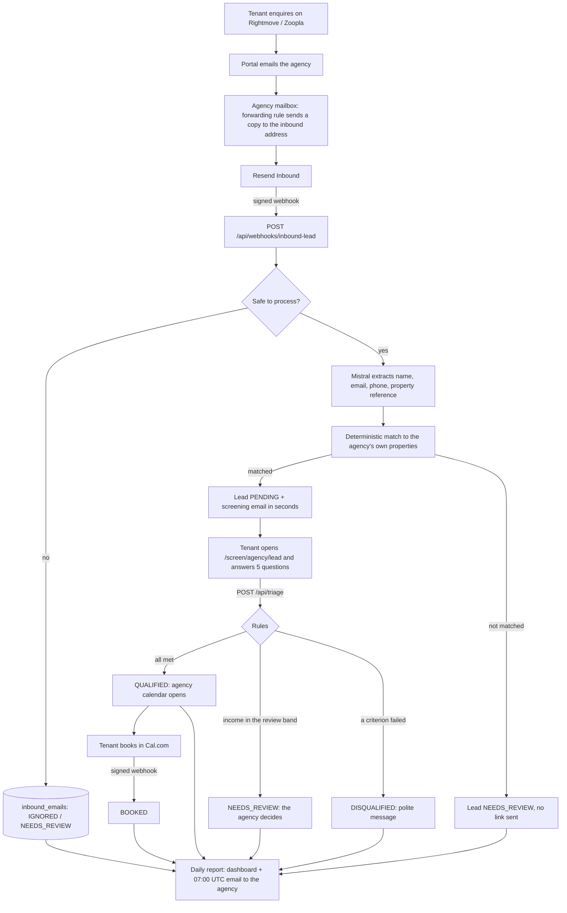
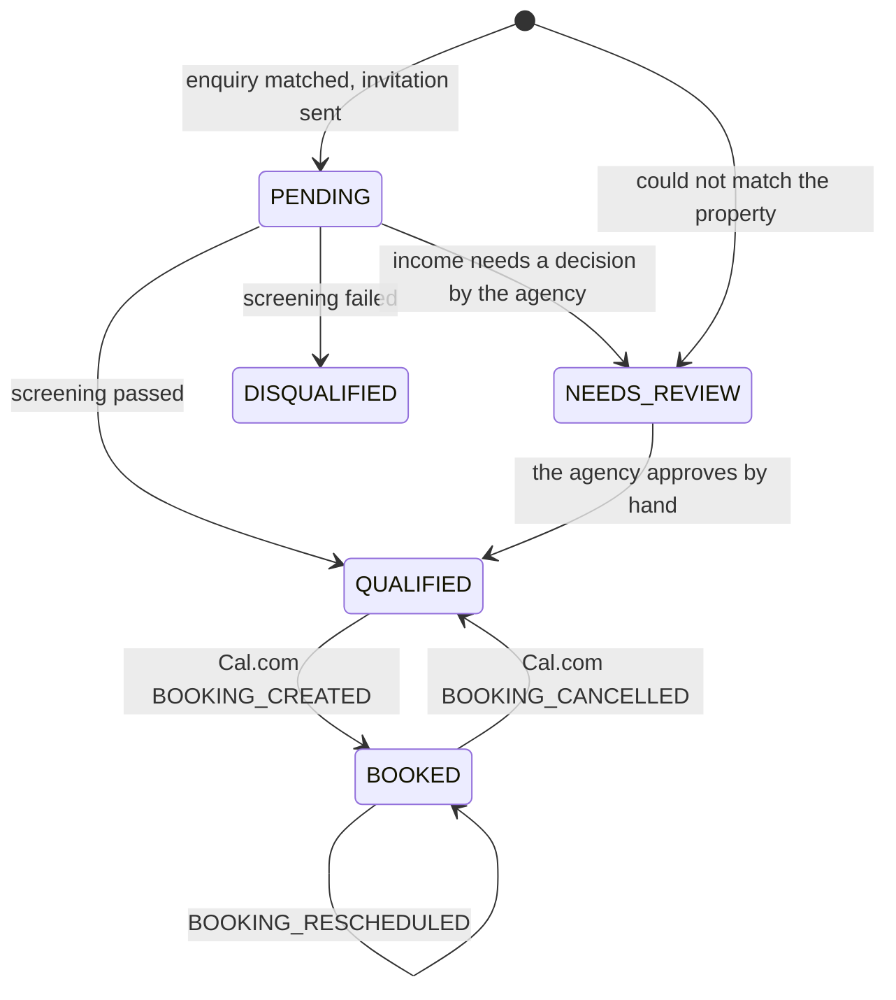

# Flint

*Flint: the deterministic front desk for UK lettings agencies.*

Flint is a managed, invitation-only service that acts as a **deterministic front desk** for independent UK lettings agencies (London, Zones 2 to 5). It answers portal enquiries in seconds, screens applicants against fixed rules, books viewings for qualified applicants, and tells the agency each morning what happened and what needs a person.

- **Not a public SaaS.** No user accounts, no log-in, no sign-up. The home page is a credibility anchor for agency managers who receive a cold email with a Loom video.
- **The language model never decides.** It only extracts applicant details from an email. Every decision (qualified or not, which property, who is booked) is made by plain code and plain rules that can be read and tested.
- **A person can always step in.** Anything the system cannot handle safely, and any applicant whose income is close to the agency's requirement, goes to `NEEDS_REVIEW` and shows at the top of the agency's report. The agency also keeps the original enquiry in its own inbox, because the setup forwards a *copy*.

### How to read this document

| If you want to... | Read |
|---|---|
| Understand the product in five minutes | 1, 3 |
| Know what every file is and does | 4, **5** |
| Understand one flow end to end | 7 (inbound), 8 (screening), 9 (booking), 10 (reporting) |
| Set it up or onboard an agency | 11, 12, 13 |
| Fix something that broke | 15 |
| Judge the security and legal position | 16, 17 |

---

## Contents

1. [How it works](#1-how-it-works)
2. [Tech stack and dependencies](#2-tech-stack-and-dependencies)
3. [Design principles](#3-design-principles)
4. [Repository map](#4-repository-map)
5. [File-by-file reference](#5-file-by-file-reference)
6. [Data model](#6-data-model)
7. [Inbound enquiry pipeline](#7-inbound-enquiry-pipeline)
8. [Screening](#8-screening)
9. [Booking (Cal.com)](#9-booking-calcom)
10. [Reporting](#10-reporting)
11. [Environment variables](#11-environment-variables)
12. [Setup from scratch](#12-setup-from-scratch)
13. [Onboarding a new agency](#13-onboarding-a-new-agency)
14. [Local development and tests](#14-local-development-and-tests)
15. [Operations and troubleshooting](#15-operations-and-troubleshooting)
16. [Security and privacy](#16-security-and-privacy)
17. [Known limitations and unverified assumptions](#17-known-limitations-and-unverified-assumptions)
18. [Deferred work](#18-deferred-work)
19. [Conventions](#19-conventions)
20. [Glossary](#20-glossary)

---

## 1. How it works



### Lead status



| Status | Meaning | Set by |
|---|---|---|
| `PENDING` | Invitation sent, applicant has not finished the questions | inbound webhook |
| `QUALIFIED` | Met every criterion; may book (and may not have booked yet) | `/api/triage`, Cal cancel, or by hand after a review (section 8) |
| `DISQUALIFIED` | Did not meet a criterion | `/api/triage` |
| `BOOKED` | Has a viewing in the agency calendar | Cal.com webhook |
| `NEEDS_REVIEW` | Needs a human. `review_reason` says why: the enquiry could not be matched to a property (**no screening link was sent**), or the applicant answered the questions and their income needs the agency's decision (section 8) | inbound webhook, `/api/triage` |

The screening page resumes wherever the applicant stopped: a `QUALIFIED` person who reopens the link sees the calendar again, a `BOOKED` person sees their viewing time, a `DISQUALIFIED` person sees the polite message, and a `NEEDS_REVIEW` person who answered the questions sees "Answers received".

---

## 2. Tech stack and dependencies

| Layer | Choice | Notes |
|---|---|---|
| App | Next.js (App Router, TypeScript) | Server components load data; one client component per interactive area |
| Database | Supabase (Postgres) | Accessed **server-side only** with the service-role key. RLS is on, with no policies |
| Email in/out | Resend | Inbound webhooks (Svix-signed) and outbound sending |
| Extraction | Mistral (`ministral-3b-latest` by default) | Extraction only, JSON mode, temperature 0 |
| Calendar | Cal.com | One account and one webhook per agency |
| Hosting | Vercel | One Cron job for the daily report |
| Styling | Plain CSS with a prefix per area (`.sc-`, `.rp-`); the home page carries its own CSS | One palette everywhere |
| Fonts | Newsreader (headings) and Inter (text) through `next/font/google` | Shared in `lib/fonts.ts` |

**Packages the code relies on:** `@supabase/supabase-js`, `resend` (a version that has `webhooks.verify` and `emails.receiving`), `@mistralai/mistralai`, `zod`, `server-only`, and `tsx` (dev, to run the scripts).

```bash
npm i zod server-only
npm i -D tsx
```

---

## 3. Design principles

1. **Deterministic by design.** Rules live in `lib/triage-rules.ts`, matching in `lib/parser/match-property.ts`, state changes in `lib/calendar/transitions.ts`. All are pure functions. The matching and the state changes have tests; the screening rules have none at the moment (section 18).
2. **Treat every email as hostile.** Anyone can email an inbound address. Sender allow-list, subject filter, "the address must literally appear in the email", name sanitising, HTML escaping, a per-hour cap, and a fixed invitation template. The property shown in the invitation comes from our database, never from the email.
3. **Idempotent everywhere.** Webhooks are retried, so: unique `resend_email_id`, unique `source_email_id` per lead, unique `(agency, trigger, booking uid)` per calendar event, Resend idempotency keys, one report per agency per day.
4. **Nothing is lost silently.** Every inbound email is logged with a status and a reason. Failures answer 500 so the provider retries.
5. **Privacy by design.** Report emails carry first name and last initial only. Contact details live behind a private expiring link. Income figures are never shown after screening. Rejection and review reasons are stored as codes, not numbers. Public pages never show internal error text.
6. **One source of truth per rule.** The date window, the two multipliers and the London-time helpers each exist once (`lib/triage-config.ts`, `lib/dates.ts`).
7. **Honest wording.** The product is an *initial pre-qualification*. It is not a credit check, a reference, a Right to Rent check or an offer of a tenancy, and the copy says so.

---

## 4. Repository map

```
app/
  page.tsx                                   Home page
  icon.svg, apple-icon.png, favicon.ico      The Flint icon (violet square, yellow spark)
  robots.ts                                  Keeps private paths out of crawlers
  layout.tsx, globals.css                    Site title, description and global styles (not covered here)
  screen/
    screening.css                            Styles for the screening pages
    [agencySlug]/[leadId]/page.tsx           Tenant screening page
  report/
    report.css                               Styles for the dashboard
    [agencySlug]/page.tsx                    Agency dashboard
  api/
    triage/route.ts                          POST: screening rules
    webhooks/
      inbound-lead/route.ts                  POST: Resend inbound email
      cal-booking/[agencySlug]/route.ts      POST: Cal.com bookings
    cron/daily-report/route.ts               GET: daily job

components/
  screening-form.tsx   qualified-confirmation.tsx   calendar-embed.tsx
  polite-rejection.tsx   under-review.tsx   booked-confirmation.tsx
  report/dashboard.tsx   report/leads-table.tsx

lib/
  brand.ts   fonts.ts   dates.ts   triage-config.ts   triage-rules.ts   triage-service.ts
  supabase/server.ts
  email/resend.ts   email/screening-invitation.ts
  inbound/senders.ts   inbound/sanitize.ts
  parser/extract-lead.ts   parser/match-property.ts
  calendar/signature.ts   calendar/build-url.ts   calendar/transitions.ts
  billing/access.ts
  report/  config  labels  format  model  build  story  load  links  tokens  range  window
           digest-email  ops-email  run-daily  demo-data  seed

types/index.ts
supabase/migrations/  001 ... 007
scripts/              ten test files, fake-db, seed-demo, create-report-link, email-preview
vercel.json           .env.example           README.md
```

Files that exist in the repository but are not documented here: `layout.tsx`, `globals.css`, `next.config.ts`, `eslint.config.mjs`, `package.json`, `tsconfig.json`, `AGENTS.md`, `CLAUDE.md`.

---

## 5. File-by-file reference

Each entry says what the file is for, what it contains, who uses it, and anything surprising about it.

### 5.1 Home page

**`app/page.tsx`** is the public face. A single self-contained client component with its own CSS string and its own font loading (it does not use `lib/fonts.ts`).

- **What a visitor sees:** a centred headline ("Every tenant enquiry answered before breakfast."), one short paragraph, two buttons, a line saying the service works with "a select number of independent agencies across London, Zones 2 to 5", and three overlapping cards at the bottom that tell the story of one enquiry: *an enquiry arrives at 23:42 and is answered in 8 seconds*, *all four lettings criteria met*, *viewing booked for Saturday at 11:30*.
- **Interactions:** clicking a side card brings it to the centre; the "Follow one enquiry" button steps through the three cards automatically, once. "Request an introduction" opens an email to `CONTACT_EMAIL`. Motion is limited to the cards rising once on load, and it is disabled when the visitor prefers reduced motion.
- **Decorations:** a lavender-to-cream-to-pale-yellow background with a faint grid, a violet circle with a house, a yellow circle with a moon (night-time enquiries), and an arch with a keyhole behind the left card.
- **By design it has:** no header, no navigation, no log-in, no pricing, no aggressive calls to action.
- **Two values to set before launch:** the product name comes from `lib/brand.ts` (`Flint`), and `CONTACT_EMAIL` (the mailbox that receives introduction requests) must be a real address you read. The page is a client component, so it cannot export `metadata`: the site title, description and icon are set in `layout.tsx`, and the icon files live in `app/`.

### 5.2 Screening (what the tenant sees)

**`app/screen/[agencySlug]/[leadId]/page.tsx`** is the tenant's page, a server component.

- Loads the lead through `getLeadScreeningData`. If the link is invalid, expired or the load failed, it shows a small "Link Unavailable" card with a generic message.
- Otherwise it shows the property address as the title, the agency name and rent ("£2,000 pcm") under it, and a white card whose content depends on the lead status: the **form** (`PENDING`), the **calendar** (`QUALIFIED`), the **polite message** (`DISQUALIFIED`), the **"Answers received" notice** (`NEEDS_REVIEW`), the **booked confirmation** (`BOOKED`), or "Already Completed" with the status for anything unexpected.
- Exports `metadata` with `noindex` and `no-referrer`, so personal links stay out of search results and Referer headers.

**`app/screen/screening.css`** holds every `.sc-*` style for the screening pages: the background, the card, the large serif income field, the confirmation rows, the pill buttons, the notices, and the wide layout for laptops (income tile on the left, the rest on the right; the calendar beside the confirmation from 1180px). It is plain CSS so it behaves the same under Tailwind v3 and v4.

**`components/screening-form.tsx`** is the form (client component). Five answers: annual household income (large serif figures, with a one-line hint under the label saying that benefits, pensions and other regular income count; the hint has the class `sc-hint`, to be styled in `screening.css`), target move-in date (typed as `dd/mm/yy`, or chosen with the calendar button; today to 180 days ahead, London time), and three yes / no questions (right to rent in England; any active CCJs; "If needed, could you provide a guarantor who lives in the UK?"). It posts to `/api/triage` and then replaces itself with the calendar, the "Answers received" notice, the polite message, or an inline error, following the `outcome` the server returns.
Notes: none of the three questions has a default answer, and the submit button stays disabled until all are answered. This matters because an unanswered question must never count as "yes", and a "no" can reject the applicant automatically. The server receives three booleans: `hasRightToRent`, `hasNoCCJ` (the answer "No" to the CCJ question) and `canProvideUkGuarantor`. The guarantor question is asked of everyone, so the form never reveals the thresholds; it only matters when income is below the requirement (section 8). The form never receives the multipliers. The `monthlyRent` prop is accepted but unused.

**`components/qualified-confirmation.tsx`** is the "Pre-qualification Confirmed" panel with the calendar. If the agency has no usable calendar link it shows "Calendar currently unavailable. The lettings team will contact you directly."

**`components/calendar-embed.tsx`** is only the Cal.com `iframe` wrapper (title "Select Viewing Slot", lazy loaded).

**`components/polite-rejection.tsx`** is the message for applicants who did not qualify: an information icon, "Application Notice", and two short paragraphs. It does not say why, and never shows numbers.

**`components/under-review.tsx`** is the "Answers received" notice for an applicant whose answers need the agency's decision: a check icon, and "The lettings team will review them and contact you directly about the next step." It never shows a calendar and never says why.

**`components/booked-confirmation.tsx`** is "Viewing Booked", showing the viewing time in London time when known.

### 5.3 Report dashboard (what the agency sees)

**`app/report/[agencySlug]/page.tsx`** is the dashboard route (server component, always rendered per request).

1. Reads the `t` (token) and `range` query parameters.
2. Checks the token with `resolveReportLink`; if invalid it shows a "Link unavailable" card.
3. Loads rows (`loadReportRows`), resolves the date range, builds the model (`buildReport`) and renders `Dashboard`.
4. Exports `metadata` with `noindex`, `nocache` and `no-referrer`.

**`app/report/report.css`** holds the `.rp-*` styles. The page uses the **full width of the screen** (capped at 1920px on very large monitors) with two columns of **equal height** from 1180px: a **left rail for what to do** (needs attention, upcoming viewings; the attention list takes the space that is left and scrolls inside it) and a **main area for what happened**. "By property" and "Every enquiry" run across the whole width underneath. Below 1180px it is one column ordered summary, numbers, attention, viewings, charts, tables; on a phone the table rows turn into cards. Chart tooltips are pure CSS, and the cards rise once on load (disabled for visitors who prefer reduced motion).

**`components/report/dashboard.tsx`** lays the page out:

- **Header:** agency name, "Enquiry report", the period and the update time, and the range pills (today, 7 days, 30 days).
- **Left rail:** *Needs your attention* (a coloured tag, the reason, how long ago, click-to-call and click-to-email) and *Upcoming viewings*. An applicant whose income needs a decision appears here as "Needs review", with the reason "Income is close to your affordability requirement" or "Income is below your requirement, but the applicant can provide a UK guarantor". Income figures are not shown, so the agency asks the applicant for proof.
- **Summary band** (top of the main area): one sentence that tells the story, for example "19 of 41 enquiries arrived while your office was closed.", followed by how fast applicants were invited, how many viewings were booked and how many items need attention, next to a small chart of all enquiries against the out-of-hours part.
- **Six headline numbers:** enquiries, time to invite, completed the questions, qualified, viewings booked, not qualified. Each is compared with the previous period when one exists.
- **Charts:** *Enquiries by day* (out of hours versus office hours) and *When enquiries arrive* (by hour of the day, with the office hours shaded).
- **Insight:** *From enquiry to viewing* (funnel) and *How enquiries ended up* (a single bar split into booked, qualified but not booked, not qualified, in progress and needs review, then the reasons applicants did not qualify, ranked).
- **Full width:** *By property* (share bar plus enquiries, qualified, booked and not qualified for each listing) and *Every enquiry*.
- **Footer:** answers are self-declared, income is never shown, when the link expires, and "Prepared by Flint for the agency".

**`components/report/leads-table.tsx`** (client) is the "Every enquiry" table: status tabs with counts, a search box (name, email, phone, property), 25 rows at a time with "Show more", and click-to-call and click-to-email links.

### 5.4 API routes and webhooks

**`app/api/triage/route.ts`** (`POST`) applies the screening rules. Validates the answers, loads the lead, refuses unknown, processed or expired leads, evaluates the rules with the agency's two multipliers, and stores status, declared answers (including the guarantor answer), failure codes, `review_reason` and `screened_at` in one conditional update (only if the lead is still `PENDING`). It returns an `outcome` (`qualified`, `review` or `rejected`) and, for a qualified applicant, the booking link. A qualified applicant, or one waiting for the agency's decision, also gets a fresh window, so the link stays open while the agency decides. Details and HTTP codes are in section 8.

**`app/api/webhooks/inbound-lead/route.ts`** (`POST`) is the Resend inbound webhook: verify, find the agency, log, filter, check that the agency has access, fetch the body, extract, verify, match, create the lead, send the screening email. Section 7.

**`app/api/webhooks/cal-booking/[agencySlug]/route.ts`** (`POST`) is the Cal.com webhook for one agency. The slug in the URL selects the signing secret. Section 9.

**`app/api/cron/daily-report/route.ts`** (`GET`) runs the daily job. Requires `Authorization: Bearer $CRON_SECRET`. Supports `?dry=1`, `?force=1` and `?agency=<slug>`. A thin wrapper around `runDailyReports`.

### 5.5 Library

#### Foundations

**`lib/supabase/server.ts`** exports `supabaseAdmin`, the service-role client. It bypasses Row Level Security, so it runs **only on the server**: `import 'server-only'` makes the build fail if a client component imports it. It fails fast with the name of any missing variable, disables session persistence, and forces `cache: 'no-store'` on every request so a lead's status is never served from a cache.

**`lib/brand.ts`** exports `BRAND_NAME` (`Flint`), the product name in one place. The home page, the dashboard footer, the daily report email and the default sender name of that email read it from here.

**`lib/fonts.ts`** exports the `serif` (Newsreader) and `sans` (Inter) font loaders with CSS variables `--lk-serif` and `--lk-sans`, used by the screening and report pages.

**`lib/dates.ts`** is every date calculation, always in London time:
`londonDate(now)` (today as `YYYY-MM-DD`), `isValidIsoDate` (rejects 30 February), `addDays` (calendar arithmetic, immune to clock changes), `londonParts` (date, hour and weekday of an instant), `londonMidnight` (the exact instant a London day begins, correct across clock changes). Three helpers handle the UK display format used by the screening form: `maskUkDate` (shapes what a person types into `dd/mm/yy`, accepting a four-digit year and padding `5/1/26`), `parseUkDate` (`dd/mm/yy` or `dd/mm/yyyy` to `YYYY-MM-DD`, or `null` unless it is a real date; a two-digit year means 20yy) and `formatUkDate` (the reverse). Stored and sent dates always stay `YYYY-MM-DD`.

**`lib/triage-config.ts`** has the tunable numbers: `DEFAULT_INCOME_MULTIPLIER = 30`, `DEFAULT_MIN_INCOME_MULTIPLIER = 27` and `MOVE_IN_MAX_DAYS = 180`. Tiny on purpose, so client components can import it.

**`types/index.ts`** holds the shared types: `LeadStatus`, `TriageInput`, `FailureCode`, `ReviewReason`, `TriageResult`, `Agency`, `Property`.

#### Screening

**`lib/triage-rules.ts`** is the heart of the decision.
- `parseTriageInput` validates what the browser sent: the three booleans must be real booleans (the string `"false"` is rejected), income a finite number between 0 and 100 million, move-in date a real date, not in the past, within 180 days. Its error messages are safe to show to the tenant.
- `evaluateTenantTriage` applies the rules (section 8) and returns **codes only**: failure codes (`INCOME_BELOW_THRESHOLD`, `NO_RIGHT_TO_RENT`, `ADVERSE_CREDIT`) or a review reason (`income_borderline`, `income_low_guarantor_offered`), never figures. The result has `isQualified`, `failureCodes`, `reviewReason` and `nextAction` (`SHOW_CALENDAR`, `SHOW_REVIEW` or `SHOW_REJECTION`).
- `resolveMultiplier` turns a missing or invalid multiplier into 30, so a misconfigured agency never qualifies everyone.
- `resolveMinMultiplier` turns a missing or invalid minimum into 27 and never lets it exceed the qualifying multiplier.
- `FAILURE_LABELS` is the plain-English wording of the failure codes used in reports (the wording of the review reasons is in `lib/report/labels.ts`).

**`lib/triage-service.ts`** exports `getLeadScreeningData`, which loads one lead with its property and agency for the screening page: checks the agency matches the link, checks expiry, builds the booking link, and returns the status, the address, the rent and the viewing time. Anything wrong returns a **generic message** (never database or internal text); the real error goes to the server log (its message only). There are three texts. "This link is not valid." is given for a malformed id, an unknown lead and an agency mismatch alike, so the page cannot be used to discover which leads exist; a malformed id is refused before the database is touched. "This invitation link has expired." is the expiry message. "We could not load this page. Please try again in a few minutes." covers a database or unexpected error.

#### Outgoing email

**`lib/email/resend.ts`** exports the Resend client, `sendScreeningInvitation` (the tenant's email, with reply-to set to the agency, an idempotency key per lead, and an explicit success or error result, because Resend returns errors instead of throwing) and `sendTransactionalEmail` (generic, used by the daily report and the owner summary). The sender address comes from `EMAIL_FROM_ADDRESS`.

**`lib/email/screening-invitation.ts`** renders the invitation as HTML plus plain text: agency name, "Thanks for your enquiry about ...", the four topics we will ask about (the guarantor question is not listed yet), a "Continue your enquiry" button with a copy-paste fallback link, and honest small print (not a credit check, not an offer of a tenancy, link expires in N days). Table layout, inline styles, no remote images. Also exports the helpers `escapeHtml`, `oneLine` and `safeDisplayName` (keeps headers and display names free of line breaks and quotes).

#### Inbound email

**`lib/inbound/senders.ts`** decides who may trigger the pipeline: `PORTAL_SENDERS` (Rightmove's two addresses and Zoopla's), `bareAddress` (extracts `a@b.com` from `Name <a@b.com>`), `isAllowedSender` (portal, the agency's `forwarding_senders`, or a dev-only extra), `isSystemAddress` (portal, agency inbound or forwarding mailbox: these can never become a tenant address), and `isLettingsEnquirySubject` (accepts "lettings"; otherwise accepts a generic "enquiry" unless it mentions sales, valuation, commercial, buyer or vendor).

**`lib/inbound/sanitize.ts`** treats everything extracted from an email as hostile: `cleanName` (letters, spaces, apostrophes, hyphens and dots only; at most 60 characters; falls back to "there"), `cleanPhone` (at least seven digits), `htmlToText`, `boundedText` (caps the text sent to the model at 8,000 characters), and `emailAppearsIn` (true only if the address literally appears in the email, which stops the model inventing one).

#### Parsing

**`lib/parser/extract-lead.ts`** exports `extractLeadFromEmail`, which asks Mistral for name, email, phone and property reference as JSON, with instructions to treat the email as data and ignore any instructions inside it. The answer must pass a zod schema; an invalid answer returns `null` (the email goes to review). A transient failure (network, rate limit) throws `ExtractionError` so the webhook answers 500 and Resend retries.

**`lib/parser/match-property.ts`** exports `matchProperty`, which finds the agency's property an enquiry is about. In order: agency reference, then portal listing id, then address (every identifying word of the address must appear, with `Rd` = `Road` style normalisation, postcodes ignored, and "flat" or "London" not counted). A method wins only if **exactly one** property matches; an ambiguous result (for example a building with several flats and no flat number) counts as no match.

#### Booking

**`lib/calendar/signature.ts`** exports `verifyCalSignature`: HMAC-SHA256 (hex) of the raw body with the agency's secret, compared in constant time.

**`lib/calendar/build-url.ts`** exports `buildCalendarUrl`: the agency's calendar link plus the applicant's name and email (prefill) and `metadata[leadId]`. Refuses non-`https` links.

**`lib/calendar/transitions.ts`** exports `decide`, the booking state machine as a pure function: `QUALIFIED` becomes `BOOKED` on creation; a cancellation reverts only if it is the *current* booking; a booking for a lead that never qualified is `REJECT`ed; unknown events are ignored.

#### Billing

**`lib/billing/access.ts`**: who may use the service, as pure functions. One fact decides: `agencies.access_until`, the moment access ends. `accessStatus` derives `NOT_STARTED`, `ACTIVE`, `GRACE` (three days after the end, applied here and never stored) or `EXPIRED` from it and the current time, so nothing has to expire an agency; it throws when the value was not loaded instead of guessing. `isEntitled` is the yes or no the inbound webhook uses. `accessAttention` feeds the owner summary (lenient, never decides access). `extendAccess` is the payment rule: one 30-day period counted from the payment's own time, never earlier than what the agency already has. Section 13 shows how the date is set.

#### Reporting

**`lib/report/config.ts`**: the range options (today, 7 days, 30 days), `parseRange`, office hours (09:00 to 18:00; weekends are out of hours), the 60-day look-back, the 24-hour "stale invitation" threshold and the 7-day link lifetime.

**`lib/report/labels.ts`**: the plain-English wording for statuses, review reasons (including the two income reasons) and booking exceptions.

**`lib/report/format.ts`**: London-time formatting (`fmtDateTime`, `fmtTime`, `fmtDay`, `fmtWeekdayDay`, `fmtLongWhen`) and `fmtDuration`, `fmtAge`, `fmtPercent`, `fmtDelta`.

**`lib/report/model.ts`**: the types of the database rows the report reads and of the finished report (`ReportModel`).

**`lib/report/build.ts`**: `buildReport` turns rows into every number and list on the dashboard and in the email: the headline numbers, the funnel, enquiries by day and by hour of the day, the ranked reasons for not qualifying, the attention list, upcoming viewings and the per-property table. A pure function (it receives `now`), so each number is testable. Also exports `isOutOfHours` and `median`.

**`lib/report/load.ts`**: `loadReportRows`, the only database queries the report needs (60 days of leads, upcoming booked viewings, properties, inbound log, booking exceptions).

**`lib/report/range.ts`**: `resolveRange`, whole London days ending now.

**`lib/report/story.ts`**: `buildStory`, the one-sentence summary at the top of the dashboard. Pure, so the wording for singular, plural, empty and all-or-nothing periods is tested.

**`lib/report/links.ts`**: `createReportLink` and `resolveReportLink`, the magic links (section 10).

**`lib/report/tokens.ts`**: `generateReportToken` (256 random bits), `hashReportToken` (SHA-256) and `isPlausibleToken`.

**`lib/report/window.ts`**: `computeWindow`, the period a daily report covers: from the last report actually sent, 24 hours by default, never more than 96.

**`lib/report/digest-email.ts`**: the daily email for the agency (`renderDailyDigest`, `digestSubject`, `shouldSendDigest`, `shortName`).

**`lib/report/ops-email.ts`**: the owner's plain-text summary (`renderOpsSummary`, `opsHasIssues`), including the access section: agencies whose access is running out and the enquiries turned away for lack of access.

**`lib/report/run-daily.ts`**: `runDailyReports`, the whole daily job (section 10).

**`lib/report/demo-data.ts`** and **`lib/report/seed.ts`**: a deterministic fictional demo agency (6 properties, 40 enquiries over 30 days) and the code that writes or removes it in the database. `DEMO_SLUG` (`demo-lettings`) is the only agency the seeding may ever touch.

#### Brand assets and crawlers

**`app/icon.svg`**, **`app/apple-icon.png`** and **`app/favicon.ico`** are the Flint icon: a violet rounded square with a four-pointed yellow spark (flint makes sparks), in the same two colours as the rest of the product. Next.js serves them automatically. **`app/robots.ts`** asks crawlers to stay away from `/screen/`, `/report/` and `/api/`; those pages also carry `noindex`.

### 5.6 Database migrations

| File | What it does |
|---|---|
| `001_add_needs_review.sql` | Adds `NEEDS_REVIEW` to the status enum. Run **alone** first |
| `002_inbound_hardening.sql` | `NOT NULL` and defaults, unique and lookup indexes, `updated_at` trigger, the `inbound_emails` table, new agency, property and lead columns, RLS |
| `003_booking.sql` | `cal_webhook_secret`, `viewing_starts_at`, the `calendar_events` table |
| `004_contact_email.sql` | `agencies.contact_email` |
| `005_reporting.sql` | `screened_at`, `report_enabled`, `report_links`, `report_runs` |
| `006_billing.sql` | `agencies.access_until`. Existing agencies are given access until 2099 (once); a new agency starts with none |
| `007_affordability_review.sql` | `agencies.min_income_multiplier` (default 27) and `leads.can_provide_uk_guarantor`. Does not touch the status enum |

### 5.7 Scripts

Tests (each is a plain script, no database or network needed):

| File | What it proves |
|---|---|
| `inbound.test.ts` (27) | Sender and subject filters, sanitising, property matching |
| `calendar.test.ts` (20) | Signature checks, booking link, every booking transition |
| `email.test.ts` (11) | Invitation content, escaping, header safety, honest wording |
| `report.test.ts` (30) | London time, every report number (including by-hour and reasons), the summary sentence, demo-data invariants |
| `digest.test.ts` (14) | Daily email privacy and content, report window, owner summary |
| `daily.test.ts` (13) | The whole daily job against an in-memory database |
| `links.test.ts` (6) | Magic-link creation, expiry, revocation, cross-agency refusal |
| `seed.test.ts` (5) | Demo seeding and safe deletion |
| `billing.test.ts` (25) | Access status and its exact boundaries, the owner-summary warnings, the payment rule |
| `ukdate.test.ts` (15) | The `dd/mm/yy` helpers: masking while typing, parsing, formatting |

Tools:

| File | Use |
|---|---|
| `fake-db.ts` | An in-memory stand-in for the Supabase client (test helper) |
| `seed-demo.ts` | Creates or replaces the fictional demo agency and prints a dashboard link |
| `create-report-link.ts` | Prints a private dashboard link for any agency |
| `email-preview.ts` | Writes `email-preview.html` for the invitation email |

### 5.8 Root files

**`vercel.json`** schedules the daily report: `GET /api/cron/daily-report` at 07:00 UTC. **`.env.example`** lists every environment variable.

---

## 6. Data model

### Tables

**`agencies`**: one row per client agency.

| Column | Notes |
|---|---|
| `id`, `name`, `slug` | `slug` is unique and appears in URLs |
| `inbound_email` | Unique, lowercase. Use an unguessable address (section 13) |
| `calendar_url` | `https` Cal.com booking link for viewings |
| `income_multiplier` | `NOT NULL`, default 30. An applicant qualifies automatically with an annual income of at least monthly rent x multiplier |
| `min_income_multiplier` | `NOT NULL`, default 27. From this multiplier up to `income_multiplier` the agency decides; below it the applicant is rejected unless they offered a UK guarantor (then the agency decides too). Never used above `income_multiplier` (section 8) |
| `contact_email` | Reply-To on invitations and recipient of the daily report |
| `forwarding_senders` | The agency's own mailbox addresses that forward portal emails (allow-list) |
| `cal_webhook_secret` | Verifies that agency's Cal.com webhook |
| `report_enabled` | Switch for the dashboard and the daily email |
| `access_until` | End of the pilot or paid period (section 13). `NULL` = never activated: new enquiries are ignored. Migration `006` gave existing agencies 2099 |

**`properties`**: the agency's listings. `reference` (unique per agency, case-insensitive), `portal_listing_id` (unique per agency), `address`, `monthly_rent`, `is_active`.

**`leads`**: one enquiry from one applicant.

| Column | Notes |
|---|---|
| `status` | `lead_status` enum (section 1) |
| `tenant_name`, `tenant_email` (lowercase), `tenant_phone` | From the email, sanitised |
| `property_id`, `raw_property_ref` | Matched property, and the text as written in the email |
| `source_email_id` | Resend email id, unique: makes retries safe |
| `invitation_sent_at`, `invitation_error` | Outcome of sending the screening link |
| `expires_at` | The link stops working after this |
| `annual_income`, `has_right_to_rent`, `has_no_ccj`, `can_provide_uk_guarantor`, `move_in_date` | Declared answers (see section 16). The guarantor answer is `NULL` for leads screened before migration `007` |
| `failure_codes` | `text[]` of reason codes, no numbers |
| `screened_at` | When screening finished |
| `review_reason` | Why the lead is `NEEDS_REVIEW`: `property_not_matched` (before screening), or `income_borderline` / `income_low_guarantor_offered` (after screening) |
| `cal_booking_uid`, `booked_at`, `viewing_starts_at` | Booking details |
| `data_purge_at` | Reserved for the retention job (not used yet) |

**`inbound_emails`**: a log of every email the webhook receives (metadata only, no body). Unique `resend_email_id`. Status `RECEIVED`, `PROCESSED`, `IGNORED`, `NEEDS_REVIEW` or `FAILED`, with a `reason`.

**`calendar_events`**: a log of Cal.com webhooks (no personal data). Unique `(agency_id, trigger_event, booking_uid)`. Status `RECEIVED`, `APPLIED`, `NOOP`, `REJECTED` or `NO_MATCH`.

**`report_links`**: dashboard magic links; only a SHA-256 hash of the token is stored.

**`report_runs`**: one row per agency per day; `SENT`, `SKIPPED` or `FAILED`, with the window covered.

### Migrations and row level security

Run the migrations in order in the Supabase SQL editor. **Run `001` on its own first**, then the rest one at a time (Postgres cannot use a newly added enum value in the transaction that adds it). Every statement can be re-run.

RLS is enabled on every table with **no policies**. All access goes through the service-role key on the server, which bypasses RLS. If any browser code reads these tables with the public anon key it will stop working. That is intentional.

---

## 7. Inbound enquiry pipeline

`POST /api/webhooks/inbound-lead`, called by Resend for `email.received`.

1. **Verify the signature** (Svix) over the raw body with `RESEND_WEBHOOK_SECRET`. Invalid: `400`.
2. **Find the agency** from the envelope recipient (`received_for`) first, then `to`, `cc`, `bcc`, by `agencies.inbound_email`. A fallback by slug (`<slug>@<INBOUND_DOMAIN>`) exists for testing.
3. **Log the email** in `inbound_emails`. A duplicate delivery of a finished email is acknowledged and ignored; an unfinished one (crashed half-way) is resumed.
4. **Gates**, cheap and before any model call:
   - the sender must be a known portal address, one of the agency's `forwarding_senders`, or a dev-only extra sender;
   - the subject must look like a lettings enquiry;
   - the agency must have access (`access_until`, section 13), otherwise the email is logged `IGNORED / subscription_inactive`. A lead that already exists is always finished first, so nobody mid-journey is cut off;
   - at most `INBOUND_MAX_PER_HOUR` processed emails per agency per hour.
5. **Fetch the body** from Resend (the webhook carries metadata only).
6. **Extract** name, email, phone and property reference with Mistral, validated by a zod schema.
7. **Verify the extraction**: the applicant's email must literally appear in the email, and must not be a system address (prevents mail loops).
8. **Match the property** to the agency's active properties (section 5.5, parsing).
9. **Duplicate check**: the same person asking about the same property within 14 days gets no second invitation.
10. **Create the lead**: `PENDING` if matched, `NEEDS_REVIEW` (`property_not_matched`) if not.
11. **Send the screening email** once (Resend idempotency key per lead; `invitation_sent_at` recorded). If sending fails the webhook answers 500 and the retry sends it.

### Reason codes in `inbound_emails`

| Status | Reason | Meaning |
|---|---|---|
| `IGNORED` | `unknown_agency` | Nobody owns that inbound address |
| `IGNORED` | `sender_not_allowed` | Sender not on the allow-list |
| `IGNORED` | `not_a_lettings_enquiry` | Subject is not a lettings enquiry |
| `IGNORED` | `duplicate_enquiry` | Same person, same property, last 14 days |
| `IGNORED` | `subscription_inactive` | The agency has no access: never activated, or ended and the grace period is over |
| `NEEDS_REVIEW` | `rate_limited` | Too many enquiries in an hour |
| `NEEDS_REVIEW` | `empty_body` | No readable content |
| `NEEDS_REVIEW` | `extraction_failed` | The model output was not a valid lead |
| `NEEDS_REVIEW` | `email_not_in_body` | The extracted address is not in the email |
| `NEEDS_REVIEW` | `email_is_system_address` | Extracted address is a portal or agency address |
| `NEEDS_REVIEW` | `property_not_matched` | A lead exists, but no property matched (see `leads`) |
| `FAILED` | free text | Technical failure; the provider will retry |

---

## 8. Screening

### The page

`/screen/<agencySlug>/<leadId>` renders by lead status (section 1). The link is the applicant's only credential: an unguessable UUID, plus an expiry.

- **Expiry.** A link expires `LEAD_LINK_TTL_DAYS` (default 14) after the lead is created. When the applicant qualifies, or is sent to the agency for a decision, the window is renewed for `BOOKING_LINK_TTL_DAYS` so they have time to book (or the agency time to decide). Expired `PENDING` and `QUALIFIED` links show "This invitation link has expired". `BOOKED`, `DISQUALIFIED` and `NEEDS_REVIEW` pages still show their outcome.
- **Never indexed**: `noindex` and `no-referrer`.

### The rules (`lib/triage-rules.ts`)

Three things are checked. Right to Rent and credit are plain yes or no. Income has three outcomes.

| Criterion | Rule | Outcome on failure |
|---|---|---|
| Income | declared annual income against monthly rent x two multipliers (below) | qualified, sent to the agency, or rejected with `INCOME_BELOW_THRESHOLD` |
| Right to Rent | declared yes (self-declaration, see section 17) | rejected: `NO_RIGHT_TO_RENT` |
| Credit | declares no CCJs | rejected: `ADVERSE_CREDIT` |

**Income, with the defaults** (`income_multiplier` 30 and `min_income_multiplier` 27, both set per agency; example rent GBP 2,000 a month):

| Declared annual income | UK guarantor offered | Result |
|---|---|---|
| 30x rent or more (GBP 60,000 or more) | any answer | `QUALIFIED`: the calendar opens |
| from 27x up to, not including, 30x (GBP 54,000 to under 60,000) | any answer | `NEEDS_REVIEW`, reason `income_borderline` |
| below 27x | yes | `NEEDS_REVIEW`, reason `income_low_guarantor_offered` |
| below 27x | no | `DISQUALIFIED`, code `INCOME_BELOW_THRESHOLD` |

The limits are inclusive: exactly 30x qualifies and exactly 27x goes to review.

Other rules that matter:

- **A hard failure wins.** Failing Right to Rent or the CCJ question is always a rejection, whatever the income or the guarantor answer. CCJs stay an automatic rejection by decision (section 17).
- **The income code is recorded only when income is the real cause**, that is below the minimum with no guarantor. An applicant in the review band who also has a CCJ is rejected with `ADVERSE_CREDIT` alone, so the "why applicants did not qualify" ranking stays honest.
- **The guarantor question is asked of everyone**, so the form never shows where the thresholds are. The answer changes nothing at 30x or more. It is a declaration: no guarantor details are collected and the guarantor's income is not checked. That is the agency's job.
- **Safe fallbacks.** A missing or invalid `income_multiplier` becomes 30, and a missing or invalid `min_income_multiplier` becomes 27. The minimum is never used above the qualifying multiplier: if it is set higher, the review band disappears and an applicant below the requirement is rejected unless they offered a guarantor.
- **The numbers are per agency.** To change them, see section 13.

The **move-in date is recorded but is not a criterion**. It must be a real date, not in the past (London time) and within `MOVE_IN_MAX_DAYS` (180), only to catch typos.

### An applicant sent to the agency (`NEEDS_REVIEW`)

The applicant sees "Answers received": the lettings team will contact them. No calendar, no reason, no numbers. Their link stays open for `BOOKING_LINK_TTL_DAYS`.

The agency sees the lead under *Needs your attention* with the reason and click-to-call and click-to-email links. Income figures are never shown, so the agency asks the applicant for proof, as in any referencing. There is no approve button yet (section 18): the agency tells you, and the status is changed by hand in the Supabase SQL editor.

```sql
-- Approve: the applicant's own link now shows the calendar (14 = the default BOOKING_LINK_TTL_DAYS)
update public.leads
set status = 'QUALIFIED', expires_at = now() + interval '14 days'
where id = '<lead id>' and status = 'NEEDS_REVIEW' and screened_at is not null;

-- Decline
update public.leads set status = 'DISQUALIFIED'
where id = '<lead id>' and status = 'NEEDS_REVIEW' and screened_at is not null;
```

`screened_at is not null` matters: it limits the statement to leads that answered the questions. A lead that is `NEEDS_REVIEW` because no property matched has no answers and must not be approved this way. Approve **before** the applicant books: a viewing booked another way (for example from the agency's own calendar link, without the lead id) is logged as a booking that could not be linked and shows as a "Booking issue" in the report. An enquiry stays under *Needs your attention* until its status changes.

### `POST /api/triage`

Request: `{ leadId, agencySlug, formData: { annualIncome, hasRightToRent, hasNoCCJ, canProvideUkGuarantor, moveInDate } }`.

Validates strictly (the three answers must be real booleans, income a finite number), loads the lead with the agency's two multipliers, checks agency, status and expiry, evaluates the rules, and stores the status (`QUALIFIED`, `NEEDS_REVIEW` or `DISQUALIFIED`), the declared answers, the failure codes, the review reason and `screened_at`. The response is `{ outcome, calendarUrl }`: `outcome` is `qualified`, `review` or `rejected`, and `calendarUrl` is set only when qualified.

| HTTP | Meaning |
|---|---|
| 400 | Malformed request or invalid answers (message is safe to show) |
| 404 | Unknown lead or agency mismatch |
| 409 | Already processed |
| 410 | Link expired |
| 422 | The property has no rent on record |
| 500 | Database error |

---

## 9. Booking (Cal.com)

The booking link comes from `lib/calendar/build-url.ts`: the agency's `calendar_url` plus the applicant's name and email (prefill) and `metadata[leadId]`, which Cal.com returns in its webhook.

**Webhook:** `POST /api/webhooks/cal-booking/<agencySlug>`, signed in `X-Cal-Signature-256` (HMAC-SHA256 hex of the raw body) with that agency's `cal_webhook_secret`.

| Cal.com event | Effect |
|---|---|
| `BOOKING_CREATED` | `QUALIFIED` becomes `BOOKED`; stores the uid and the viewing time |
| `BOOKING_RESCHEDULED` | Updates the uid and the viewing time |
| `BOOKING_CANCELLED` | `BOOKED` returns to `QUALIFIED` (only if the cancelled uid is the current one) |

The lead is found by the known booking uid first, then by `metadata.leadId` (restricted to the same agency). A booking for a lead that never qualified (including one still waiting for the agency's decision) is **recorded as `REJECTED` and not applied**, and shows in the report's attention list. A booking that matches no lead is `NO_MATCH`. Every event is logged in `calendar_events`, and the unique key makes redeliveries harmless.

> Create the Cal.com webhook **on the viewing event type**, not on the whole account, and keep that event type on automatic acceptance (`BOOKING_REQUESTED` is ignored).

---

## 10. Reporting

### Dashboard

`/report/<agencySlug>?t=<token>`: never indexed, never cached, no cookies. Full-width layout with a rail of actions on the left and the numbers and charts on the right; contents are described in section 5.3. Income figures never appear.

### Magic links

A token is 256 random bits, shown once, valid 7 days, stored only as a SHA-256 hash, and valid only for its own agency. Revoke by setting `revoked_at` or deleting the row. Each daily email carries a fresh link.

### The daily job

`vercel.json` calls `GET /api/cron/daily-report` at 07:00 UTC (08:00 in summer, 07:00 in winter, London time) with `Authorization: Bearer $CRON_SECRET`.

For each agency with `report_enabled` and a `contact_email`:

- **Weekends are skipped** (unless `REPORT_SEND_WEEKENDS=true`), so Monday's report covers the weekend. Mondays also carry a 7-day recap.
- The report covers **everything since the last report that was actually sent** (default 24 hours, never more than 96), so a missed run leaves no gap. Cron delivery is best-effort, which is why.
- Nothing happened and nothing waits: **skipped**, no email.
- One row per agency per day in `report_runs`; a second run the same day does nothing. A failed send is recorded and retried by the next run.
- The email carries **first name and last initial only**: no phone, no email address, no income. Details are behind the private link.

The same run sends the **system owner** (`ADMIN_EMAIL`) a plain-text summary when something needs a human: failed inbound emails, enquiries the system could not handle that have waited over 24 hours (`NEEDS_REVIEW` with `property_not_matched`; an income decision belongs to the agency, so it is not counted), invitations that could not be sent, suspicious bookings, failed reports, agencies whose access ends within three days or has just ended, and enquiries turned away because an agency has no access (last 36 hours). The demo agency is excluded.

Manual use of the cron route (same Bearer header):

| Query | Effect |
|---|---|
| `?dry=1` | Build everything; send nothing and write nothing; returns the subject and a text preview |
| `?force=1` | Ignore "already done today" |
| `?agency=<slug>` | Only that agency |

### Demo agency

```bash
npx tsx --env-file=.env.local scripts/seed-demo.ts                          # create or replace "Demo Lettings", print a dashboard link
npx tsx --env-file=.env.local scripts/seed-demo.ts --email you@example.com  # it also receives the daily email
npx tsx --env-file=.env.local scripts/seed-demo.ts --delete-only
```

All data is fictional: made-up names, `example.com` emails, and phones in Ofcom's reserved `07700 900xxx` range. The script can only ever touch the agency with slug `demo-lettings`.

---

## 11. Environment variables

Copy `.env.example` to `.env.local` for development. In production set them in Vercel **before building**: `NEXT_PUBLIC_*` values are inlined at build time.

| Variable | Required | Purpose |
|---|---|---|
| `NEXT_PUBLIC_SUPABASE_URL` | yes | Supabase project URL (read by `lib/supabase/server.ts`) |
| `SUPABASE_SERVICE_ROLE_KEY` | yes | Service-role key. **Never** prefix it with `NEXT_PUBLIC_` |
| `NEXT_PUBLIC_APP_URL` | yes | Production origin, e.g. `https://yourdomain.com` (used in every emailed link) |
| `RESEND_API_KEY` | yes | Sending, and fetching inbound email bodies |
| `RESEND_WEBHOOK_SECRET` | yes | Signing secret of the inbound webhook (`whsec_...`) |
| `MISTRAL_API_KEY` | yes | Extraction |
| `CRON_SECRET` | yes | Authorises the cron route |
| `EMAIL_FROM_ADDRESS` | for real use | Verified sending address. The default `onboarding@resend.dev` only delivers to your own address |
| `ADMIN_EMAIL` | recommended | Receives the daily operations summary |
| `INBOUND_DOMAIN` | optional | Enables the `<slug>@<domain>` lookup fallback (testing) |
| `INBOUND_EXTRA_SENDERS` | dev only | Extra allowed senders for local tests. **Must be empty in production** |
| `INBOUND_MAX_PER_HOUR` | optional | Default 60 |
| `LEAD_LINK_TTL_DAYS` | optional | Default 14 |
| `BOOKING_LINK_TTL_DAYS` | optional | Default: same as `LEAD_LINK_TTL_DAYS` |
| `MISTRAL_MODEL` | optional | Default `ministral-3b-latest`. Pin an exact version once tested |
| `REPORT_SEND_WEEKENDS` | optional | `true` to send on Saturday and Sunday |
| `REPORT_FROM_NAME` | optional | Sender name of report emails (default: the product name, `Flint`) |
| `REPORT_REPLY_TO` | optional | Reply-To of report emails |

---

## 12. Setup from scratch

1. **Supabase.** Create the project and run migrations `001` to `007` in order (`001` alone first). Keep the service-role key server-side only.
2. **Resend.**
   - Create an API key.
   - **Sending:** verify a domain (SPF and DKIM records) and set `EMAIL_FROM_ADDRESS`.
   - **Receiving:** set up inbound on a **subdomain you control** (an MX record), then create a webhook for the `email.received` event pointing at `https://<domain>/api/webhooks/inbound-lead`. Copy its signing secret to `RESEND_WEBHOOK_SECRET`.
3. **Mistral.** Create an API key.
4. **Vercel.** Import the repository, set every environment variable, deploy to production. The Cron job in `vercel.json` only runs on production deployments. Use a plan that permits commercial use.
5. **Domain.** Point your domain at the deployment and update `NEXT_PUBLIC_APP_URL` (then redeploy). Before you spend on the name, check it: a domain you can own, a UK trademark search (UK IPO) in the classes for software and rental services, and a Companies House name check if you will register a company.
6. **Smoke test.** Seed the demo agency, open its dashboard link, run the cron route with `?dry=1`, and walk the acceptance checklist in section 15.

---

## 13. Onboarding a new agency

Currently manual (a script is planned, section 18).

**Collect from the agency:** its name, the mailbox that receives portal enquiries, the contact email for reports, its Cal.com viewing link, the income multiple it applies (30 times the monthly rent is the usual one) and the lowest multiple it would still look at (default 27). Also its active listings: address, monthly rent, agency reference, and the portal listing id if it has one.

**Create the rows:**

```sql
insert into public.agencies
  (name, slug, calendar_url, income_multiplier, min_income_multiplier, contact_email, inbound_email, forwarding_senders, cal_webhook_secret, access_until)
values
  ('Oakwood Lettings London', 'oakwood-london', 'https://cal.com/oakwood/viewing', 30, 27,
   'lettings@oakwood.co.uk',
   'oakwood-k3x9q2@inbound.yourdomain.com',          -- unguessable, lowercase
   array['lettings@oakwood.co.uk'],                    -- their mailbox, if it forwards
   encode(gen_random_bytes(32), 'hex'),
   now() + interval '7 days');                         -- onboarding window: the pilot starts at go-live (below)

insert into public.properties (agency_id, address, reference, portal_listing_id, monthly_rent)
select id, 'Flat 4, 12 Clapham Common South Side, London SW4', 'OAK-0142', '160123456', 2000
from public.agencies where slug = 'oakwood-london';
```

**To change an agency's affordability numbers later** (the minimum should not be higher than the first number; it only affects applicants screened from then on):

```sql
update public.agencies set income_multiplier = 33, min_income_multiplier = 30 where slug = '<slug>';
```

**Then:**

- [ ] Ask the agency to add a forwarding rule from the portal sender addresses to the inbound address. Forwarding keeps a copy in their own inbox.
- [ ] If their mail system rewrites the sender when forwarding, add their mailbox to `forwarding_senders`.
- [ ] Create the Cal.com webhook **on the viewing event type**: URL `https://<domain>/api/webhooks/cal-booking/<slug>`, events `BOOKING_CREATED`, `BOOKING_RESCHEDULED`, `BOOKING_CANCELLED`, secret = the value stored in `cal_webhook_secret`. Use the "test" button, then make a real booking and cancel it.
- [ ] Keep that event type on automatic acceptance.
- [ ] Send a real test enquiry end to end (it is ignored if `access_until` is empty or past).
- [ ] **Go live:** start the pilot (next subsection).
- [ ] Generate their first dashboard link: `npx tsx --env-file=.env.local scripts/create-report-link.ts <slug>`.
- [ ] Sign a data processing agreement (section 16) and agree what the agency tells applicants about the questionnaire.
- [ ] Tell the agency plainly: **this is an addition to your process, so keep watching your own inbox** until you trust it.

### Pilot, payment and access

One column decides whether an agency's **new** enquiries are taken on: `agencies.access_until`. You set it by hand in the Supabase SQL editor; nothing else is needed. The rules live in `lib/billing/access.ts`.

| `access_until` | Status | A new enquiry is... |
|---|---|---|
| empty (`NULL`) | not started | ignored (`IGNORED / subscription_inactive`) |
| in the future | active | processed as usual |
| up to 3 days in the past | grace | processed as usual, so a late payment or a forgotten renewal does not cut off a customer. Do not advertise the grace period |
| more than 3 days in the past | expired | ignored (`IGNORED / subscription_inactive`) |

Leads that already exist are never affected: screening, booking and the daily report keep working.

**Start the pilot** (14 days, no card) when the agency goes live:

```sql
update public.agencies set access_until = now() + interval '14 days' where slug = '<slug>';
```

**After a payment** (GBP 495 a month): first confirm the payment in Whop, then extend from the **time of the payment** (not from now). `greatest` never shortens access, and running the statement twice changes nothing:

```sql
update public.agencies
set access_until = greatest(access_until, timestamptz '2026-11-12 09:30+00' + interval '30 days')  -- the payment time
where slug = '<slug>';
```

**Stop an agency right now** (beyond the grace period):

```sql
update public.agencies set access_until = now() - interval '4 days' where slug = '<slug>';
```

**Taking payment:** create one Whop checkout link per agency (a recurring plan, GBP 495 every 30 days) and send it yourself, so the Whop dashboard shows who paid. Extending access automatically is deferred (section 18).

**What you will be told:** the owner summary (section 10) lists agencies whose access ends within three days or is in grace, and counts the enquiries turned away for lack of access. That count also exposes an agency you forgot to activate.

**When an agency leaves:** let access run out and ask them to remove the forwarding rule. Otherwise their enquiry emails keep arriving and are logged (sender and subject only, never the body) as `subscription_inactive`.

---

## 14. Local development and tests

```bash
npm install
cp .env.example .env.local        # fill in the values
npm run dev
```

### Run the tests

Every suite is a plain script and needs no database, network or browser.

```bash
npx tsx scripts/inbound.test.ts
npx tsx scripts/calendar.test.ts
npx tsx scripts/email.test.ts
npx tsx scripts/report.test.ts
npx tsx scripts/digest.test.ts
npx tsx scripts/daily.test.ts
npx tsx scripts/links.test.ts
npx tsx scripts/seed.test.ts
npx tsx scripts/billing.test.ts
npx tsx scripts/ukdate.test.ts
```

To run them all with one command, add this to `package.json` (npm runs scripts through `cmd` on Windows, where `&&` works):

```json
"scripts": {
  "test": "tsx scripts/inbound.test.ts && tsx scripts/calendar.test.ts && tsx scripts/email.test.ts && tsx scripts/report.test.ts && tsx scripts/digest.test.ts && tsx scripts/daily.test.ts && tsx scripts/links.test.ts && tsx scripts/seed.test.ts && tsx scripts/billing.test.ts && tsx scripts/ukdate.test.ts"
}
```

### What the tests cover, and what they cannot

They cover the pure logic: sender and subject filters, sanitising, property matching, signature checks, booking transitions, the access and payment rules, the `dd/mm/yy` date helpers, email content and escaping, London-time maths, every report number, and the whole daily job against an in-memory database.

They do **not** exercise the real Supabase, Resend, Mistral or Cal.com, the route handlers' wiring, or how emails render in Gmail and Outlook. Section 15 lists the manual checks.

There is currently **no test for the screening rules** (`lib/triage-rules.ts`) or for the validation of the applicant's answers: `triage.test.ts` was removed. Section 18 says what a new one should cover.

Preview the invitation email: `npx tsx scripts/email-preview.ts` writes `email-preview.html`.

---

## 15. Operations and troubleshooting

### Acceptance checklist (run on production after each significant change)

1. Real enquiry email to the inbound address: the invitation arrives, the form works, the calendar opens, a booking sets `BOOKED`, cancelling returns `QUALIFIED`.
2. A qualified applicant reopens the link: the calendar is shown again.
3. Screening with a low income and "No" to the guarantor question: `DISQUALIFIED`, and a reload shows the polite message.
4. Resend the same webhook from the Resend dashboard: still one lead, one email.
5. Enquiry about a property that is not in the database: `NEEDS_REVIEW`, no link sent, shown in the dashboard.
6. Email from a sender that is not allowed: `IGNORED / sender_not_allowed`.
7. Webhook with a bad signature (Resend or Cal.com): rejected (`400` / `401`).
8. Expired link: the "expired" message.
9. Temporarily break `RESEND_API_KEY`, then fix it: a 500 and then a single invitation on retry.
10. Sales or valuation subject: ignored.
11. Open the dashboard link, an expired one, and one for another agency; run the cron route with `?dry=1`.
12. Check everything on an iPhone and on a wide screen, and the emails in Gmail and Outlook.
13. Access: with a test agency whose `access_until` is more than 3 days in the past, a new enquiry is `IGNORED / subscription_inactive` (no model call, no invitation), and a lead that existed before can still be screened and booked. Set it to the future again: the next enquiry is processed.
14. Income review (rent GBP 2,000 a month): an income of GBP 56,000 gives `NEEDS_REVIEW / income_borderline`; the applicant sees "Answers received" and no calendar, and the lead shows under *Needs your attention*. An income of GBP 40,000 with "Yes" to the guarantor question gives `income_low_guarantor_offered`; with "No" it gives `DISQUALIFIED`. Approve one with the SQL in section 8: its link now shows the calendar.

### Symptoms

| Symptom | Likely cause |
|---|---|
| Resend webhook shows `400` | Wrong `RESEND_WEBHOOK_SECRET`, or the body was altered before verification |
| Email logged `IGNORED / unknown_agency` | `inbound_email` does not match the address mail was sent to |
| Email logged `IGNORED / sender_not_allowed` | Forwarded mail arrives from the agency's mailbox: add it to `forwarding_senders` |
| Email logged `IGNORED / subscription_inactive` | The agency has no access: `access_until` is empty or more than 3 days in the past. Set it (section 13) |
| Lead is `NEEDS_REVIEW / property_not_matched` | Property missing, or the email's reference or address differs: add `reference` or `portal_listing_id` |
| Lead is `NEEDS_REVIEW / income_borderline` or `income_low_guarantor_offered` | Working as designed: the applicant answered and the agency must decide. Approve or decline with the SQL in section 8 |
| Cal.com webhook `401` | The secret in the agency row differs from the one in Cal.com |
| Booking not marked | Check `calendar_events`: `NO_MATCH` (no `leadId` forwarded) or `REJECTED` (lead not qualified, or still waiting for the agency's decision) |
| `leads.invitation_error` is set | Sender domain not verified, wrong API key, or recipient rejected |
| No daily email | Check `report_runs` (reason), `contact_email`, `report_enabled`, `CRON_SECRET`, and that it is a production deployment |
| Dashboard says "Link unavailable" | Token expired, revoked, wrong agency, or `report_enabled` is false |
| Build fails with a Supabase variable message | `NEXT_PUBLIC_SUPABASE_URL` or `SUPABASE_SERVICE_ROLE_KEY` is not set in that environment |

### Useful queries

```sql
-- Everything that needs a human
select agency_id, status, reason, count(*) from inbound_emails
where status in ('NEEDS_REVIEW','FAILED') and created_at > now() - interval '2 days'
group by 1,2,3 order by 4 desc;

-- Leads waiting on a person
select tenant_name, review_reason, created_at from leads
where status = 'NEEDS_REVIEW' order by created_at;

-- Only the income decisions waiting for an agency
select tenant_name, review_reason, screened_at from leads
where status = 'NEEDS_REVIEW' and screened_at is not null order by screened_at;

-- Bookings that could not be linked or had no screening
select * from calendar_events where status in ('NO_MATCH','REJECTED') order by created_at desc;

-- Recent daily reports
select agency_id, run_date, status, reason from report_runs order by run_date desc limit 20;

-- Every agency's access, soonest end first (empty = never activated)
select name, slug, access_until from agencies order by access_until nulls first;

-- Enquiries turned away for lack of access
select agency_id, count(*) from inbound_emails
where reason = 'subscription_inactive' and created_at > now() - interval '7 days'
group by 1;

-- Revoke every dashboard link of an agency
update report_links set revoked_at = now() where agency_id = '<uuid>' and revoked_at is null;
```

---

## 16. Security and privacy

### Threats and mitigations

| Threat | Mitigation |
|---|---|
| Forged inbound webhook | Svix signature over the raw body |
| Anyone emails an inbound address to make us send mail | Sender allow-list, subject filter, the applicant address must appear literally in the email, system addresses refused, hourly cap, fixed email template, name sanitising, property taken from our own database |
| Mail loops | Portal, agency and forwarding addresses can never become a tenant address |
| Prompt injection in an email | Extraction only; the output is validated by schema and cross-checked with the text; the model decides nothing |
| HTML or header injection in outgoing mail | Escaping of every dynamic value, line-break stripping in subjects and display names |
| Forged booking webhook | HMAC signature with a per-agency secret; constant-time comparison |
| Booking without screening | Only `QUALIFIED` leads can become `BOOKED`; others are logged and flagged |
| Guessing a screening link | UUID, expiry, and state checked inside the update itself |
| Guessing a dashboard link | 256-bit token, hashed at rest, 7-day expiry, tied to one agency, revocable |
| Link leaks through Referer or search engines | `no-referrer`, `noindex`, `no-store` |
| Internal errors shown to the public | Public pages show generic messages; details go to the server log |
| Learning which leads exist | An unknown lead and an agency mismatch give the same message |
| Public access to tables | RLS on with no policies; service-role key server-side only and `server-only` import guard |
| Stale reads of lead status | The database client never uses a cache |
| Replays and duplicate deliveries | Unique constraints, conditional updates, idempotency keys |

### Personal data

Stored per applicant: name, email, phone (optional), the declared annual income, Right to Rent and CCJ answers, whether they could provide a UK guarantor (no guarantor details are collected), and the move-in date. Income is **never displayed** after screening, and rejection and review reasons are kept as codes.

Processors: Vercel (hosting), Supabase (database), Resend (email), Mistral (receives enquiry email text for extraction), Cal.com (receives name and email for booking).

**Retention is not implemented yet.** Declared answers are stored until a retention job exists (section 18). Decide the period before the first real agency.

### Legal notes (not legal advice: have them reviewed)

- The agency is the data controller and you are its processor: a **data processing agreement** and a privacy notice for the questionnaire are needed (UK GDPR).
- The "Right to Rent" answer is a **self-declaration used as a pre-screen**. The legal check on documents remains with the landlord or agent, before the tenancy starts.
- Since 1 May 2026 (Renters' Rights Act 2025) it is unlawful to discriminate against people receiving benefits or with children. Affordability checks remain allowed, but benefits count as income. The income question now tells applicants that benefits, pensions and other regular income count, and only three things are rejected automatically: income below the minimum with no guarantor, no right to rent, and CCJs. Have that wording and those automatic rejections reviewed by a professional.
- Cold outreach to businesses is subject to PECR rules on electronic marketing.

---

## 17. Known limitations and unverified assumptions

**Not yet verified against live services**

- Real portal emails: the property matching and the subject filter were designed from public information and synthetic samples. Zoopla's sender address comes from a third-party guide.
- Cal.com: the exact signature format and the fields sent on reschedule were assumed from documentation. Use their test button and a real reschedule to confirm.
- Whether forwarded emails keep the original `From` depends on the agency's mail system.
- The affordability numbers. 30 times the monthly rent is a market convention, not a legal rule, and some agencies use other multiples (28 and 33 are mentioned). The default minimum of 27 is a judgement call, not a standard. Keeping CCJs as an automatic rejection, while weak credit is handled with a guarantor, rests on market practice (insurers of rent guarantees are said not to cover a tenant with a CCJ). Confirm all three with the first agencies and set `min_income_multiplier` per agency.
- How the emails render in Gmail, Outlook and Apple Mail (they were checked in a standards-compliant browser only).
- The deployment itself (build, environment, function duration, cron delivery).

**Known limits**

- One recipient per agency for the daily report.
- The Right to Rent and CCJ answers and the income are self-declared and unverified. The guarantor answer is a declaration too: nothing about the guarantor is collected or checked.
- Income reviews are closed by hand (section 8). There is no approve button, and an enquiry stays under *Needs your attention* until its status is changed.
- The report loads at most 5,000 rows per query and the last 60 days.
- Cron delivery is best-effort; the report window absorbs a missed run.
- Access is extended by hand after each payment. A late or forgotten renewal shows up in the owner summary and the grace period absorbs a few days, but nothing renews automatically.
- `INBOUND_EXTRA_SENDERS` and `onboarding@resend.dev` are for testing only.
- Applicants cannot choose a move-in date beyond 180 days.

**Wording still to finalise** (copy, not code): the rejection message still says the details "have been forwarded to the lettings team for manual review"; for an automatic rejection that only means the agency can see the enquiry in its report, so decide the final sentence; the Right to Rent wording must not imply verification (the question is "Do you have the right to rent in England?", a self-declaration); have the final wording of every question reviewed, including the new income hint and the guarantor question; and the invitation email (`lib/email/screening-invitation.ts`) still lists the four original topics and says nothing about the guarantor question.

---

## 18. Deferred work

- **Tests for the screening rules**: `scripts/triage.test.ts` was removed, so the date maths, the input validation and the rules it covered have no test, and neither does the income review. A new `triage.test.ts` should cover: the exact limits (30x qualifies, 27x goes to review, just under 27x does not); the guarantor answer; a hard failure (Right to Rent or CCJ) beating a review, with only the real cause as the code; the fallbacks of `resolveMultiplier` and `resolveMinMultiplier`; and strict validation (the string `"false"`, a missing field, a past move-in date). Also give `demo-data.ts` and `report.test.ts` some income-review leads so the demo shows them. Until then, the acceptance checklist in section 15 (item 14) is the only check.
- **Closing an income review inside the product**: approve and decline buttons on the dashboard (authorised by the report token), or matching a booking made another way to the lead under review by the applicant's email (exactly one match, as with properties). Optionally take old income reviews out of *Needs your attention* after a few days. Worth building when the hand-written SQL in section 8 becomes a chore.
- **Onboarding script**: agency, properties from CSV, unguessable inbound address, secrets, and a printed checklist.
- **Whop webhook** (automatic extension after each payment): the rule already exists (`extendAccess`); it needs one route that verifies the Whop signature, accepts only `payment.succeeded` for the Flint plan, reads the agency from the checkout's `metadata` (copied to the payment) and applies `extendAccess`. Check Whop's current webhook documentation when building it: Whop retries a failed delivery only three times within about a minute, so a lost event is repaired with the SQL in section 13. Worth building when renewals become a chore.
- **Retention job**: null the declared answers after N days (the column `data_purge_at` is reserved) and prune old logs and expired links. Needs a decision on N.
- **Sender authenticity** from SPF and DKIM results, if Resend exposes them.
- **Hardening**: security headers in `next.config.ts`, `robots.ts`, an explicit `maxDuration` on the inbound webhook, integration tests for the three busiest routes.
- **Home page finishing**: set `CONTACT_EMAIL` to a real mailbox; put the site title and description in `layout.tsx` (snippet in the project notes); decide whether the home page is indexable (recommended off until launch).
- **Optional**: several report recipients, an automatic reminder for qualified applicants who have not booked, and a model fallback for property matching once real data shows how often the deterministic match fails.

---

## 19. Conventions

- **London time everywhere.** Calendar dates are `YYYY-MM-DD` strings handled by `lib/dates.ts`; never use `toISOString()` for a calendar date.
- **Pure core, thin edges.** Logic lives in pure functions under `lib/`; routes only authenticate, load, call and store.
- **No numbers in reasons.** Failure and review reasons are codes (`FailureCode`, `ReviewReason`); wording lives in `lib/triage-rules.ts` and `lib/report/labels.ts`.
- **Billing gates only new enquiries.** `agencies.access_until` is the single billing fact; the status (active, grace, expired) is always derived from it and the current time, never stored.
- **Every webhook is idempotent**, and answers 500 only when a retry will help.
- **Public pages never show internal text.** Log the detail, show a generic sentence.
- **Styling is prefixed** (`.sc-`, `.rp-`) and shares one palette: violet `#8f80e6`, ink `#1c1c1e`, lavender panel `#eae7fd`, on a lavender to cream to pale-yellow background.
- **Copy:** English, plain and honest. Never promise verification, never add pressure.
- A failing test blocks a change. A new rule or webhook gets a test first.

---

## 20. Glossary

| Term | Meaning |
|---|---|
| **Lettings** | Renting out residential property |
| **Portal** | Rightmove or Zoopla: websites where tenants find listings and send enquiries |
| **pcm** | Per calendar month (rent) |
| **CCJ** | County Court Judgment: a court order about unpaid debt, visible on credit files |
| **Pilot** | The free 14-day trial: no card, just an `access_until` date set by hand |
| **Grace period** | The 3 days after `access_until` in which new enquiries are still taken on |
| **Right to Rent** | The legal duty to check that an adult tenant may rent in England |
| **Referencing** | The agency's checks of a tenant (income, credit, previous landlord) |
| **Guarantor** | A person, here one who lives in the UK, who agrees to pay the rent if the tenant cannot. The form only asks whether the applicant could provide one |
| **Review band** | Income from `min_income_multiplier` up to `income_multiplier` times the monthly rent: the agency, not the rules, decides |
| **Out of hours** | Before 09:00, from 18:00, and weekends, London time |
| **Inbound address** | The email address the agency's portal emails are forwarded to |
| **Magic link** | A private link that works as a password, with an expiry |
| **Idempotent** | Safe to run twice: the second run changes nothing |
| **RLS** | Row Level Security: Postgres rules about who may read which rows |
| **Service-role key** | The Supabase key that bypasses RLS; server-side only |
| **Flint** | The product name (see `lib/brand.ts`) |